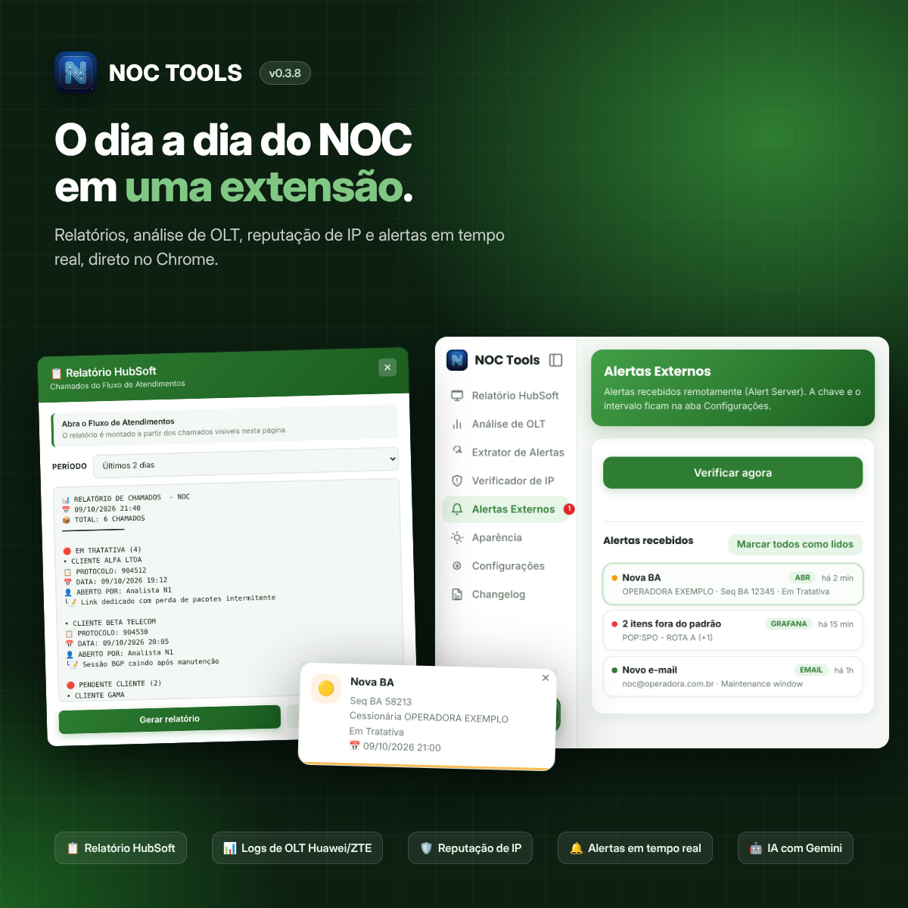
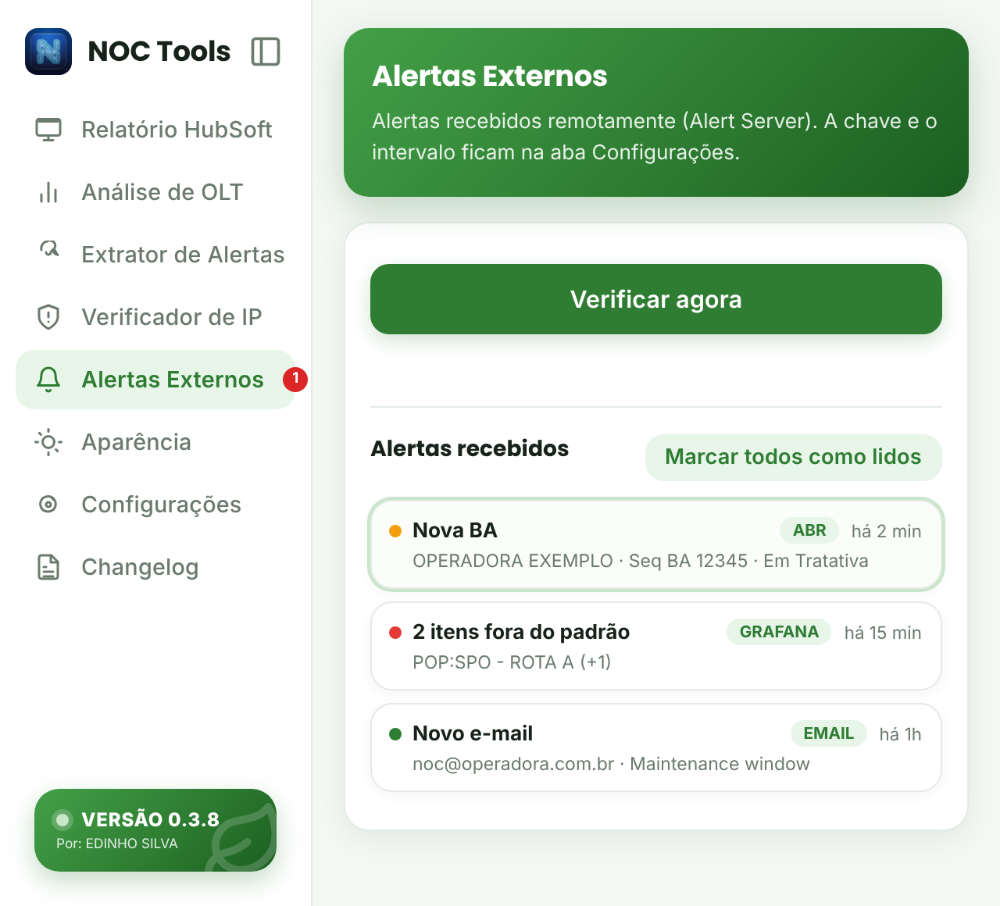
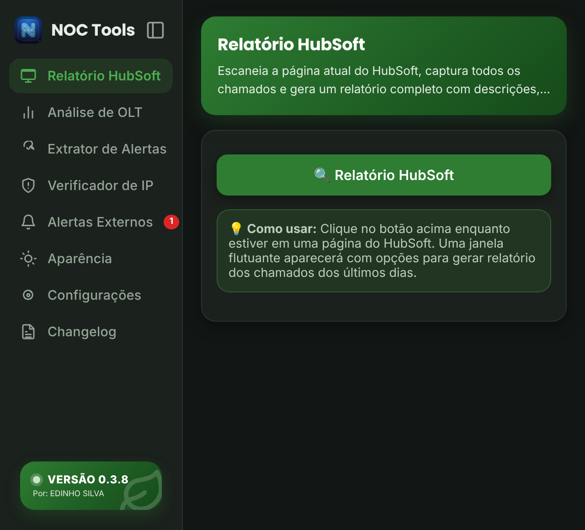
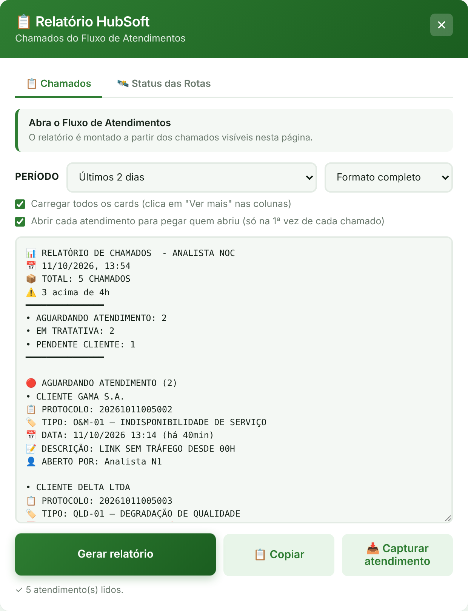
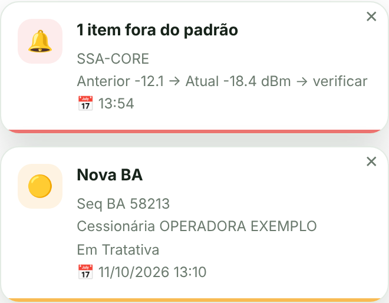

# NOC TOOLS

Extensão do Chrome (Manifest V3) com ferramentas para o dia a dia do NOC.



## Ferramentas

- **Relatório HubSoft**: lê o quadro do Fluxo de Atendimentos e monta o relatório dos chamados por categoria.
  - Carrega todos os cards (clica em "Ver mais") e abre cada atendimento sozinho para pegar quem abriu, o tipo e a descrição.
  - Mostra tempo em aberto (⚠️ acima de 4h, 🔥 acima de 24h), chamados novos (🆕) e encerrados desde o último relatório.
  - Ordem do mais novo para o mais antigo, em formato completo ou para WhatsApp/Teams.
  - Botão "Capturar atendimento" gera o resumo do chamado aberto.
- **Status das Rotas**: monta o Status Geral das Rotas a partir dos chamados do HubSoft. Classifica as falhas em maior ou menor capacidade pelos POPs do trecho, calcula o 🟢/🔴 de cada rota e guarda status, detentora e ABRs entre um relatório e outro.
- **Analisador de OLT**: interpreta logs Huawei e ZTE (ONUs offline, motivo e data).
- **Extrator de Alertas**: agrupa os alertas da página por POP.
- **Verificador de IP**: IP público, geolocalização e reputação (IPsum, Spamhaus, Barracuda, RDAP e IA).
- **Analisar com IA**: menu de contexto que usa o Gemini para sugerir respostas a partir de um texto ou imagem.
- **Alertas Externos**: recebe os alertas do ABR Monitor pelo Alert Server e mostra um aviso na página.
- **Temas**: Eco (padrão), Eco Escuro e outros. As janelas nas páginas seguem o tema escolhido.

## Telas

> As imagens usam dados de exemplo.

### Popup

| Tema Eco | Tema Eco Escuro |
|---|---|
|  |  |

### Relatório HubSoft



### Status das Rotas


### Alertas Externos na página



## Instalação

1. Baixe ou clone este repositório.
2. Abra `chrome://extensions` e ative o **Modo do desenvolvedor**.
3. Clique em **Carregar sem compactação** e selecione a pasta do projeto.

Depois de atualizar os arquivos, clique no ⟳ da extensão em `chrome://extensions`.

## Configuração

Tudo fica na aba **Configurações** do popup:

- **Chave da API Gemini**: usada pela IA, pelo Verificador de IP e pelo Analisador de OLT.
- **Chave do Alert Server**: obrigatória para receber os Alertas Externos.

As chaves ficam salvas só no navegador (`chrome.storage.local`) e não fazem parte do código.

A lista de rotas do **Status das Rotas** fica no botão **⚙️ Rotas**, dentro da própria aba, uma rota por linha:

```
ROTA RJO = JFA-MHO01 <> RJO-SCV02; JFA-SMT01 <> RJO-SCV02; RJO-SCV01 <> VTA-SUA01
```

## Estrutura

```
manifest.json            Manifesto da extensão
popup.html / .css / .js  Interface do popup
popup-alert-server.js    Aba de Alertas Externos
background/              Service worker e ferramentas injetadas nas páginas
  service-worker.js      Ponto de entrada (importScripts)
  background-tema.js     Cores dos temas aplicadas nas janelas
  background-content-hubsoft.js  Relatório HubSoft e Status das Rotas
changelog/changelog.txt  Histórico de versões (exibido ao atualizar)
docs/images/             Imagens deste README
icons/                   Ícones
```

## Versões

Veja o [changelog](changelog/changelog.txt). Cada versão é marcada com uma tag (`v0.3.8`, ...).

---

Desenvolvido por Edinho Silva.
